<p align="center">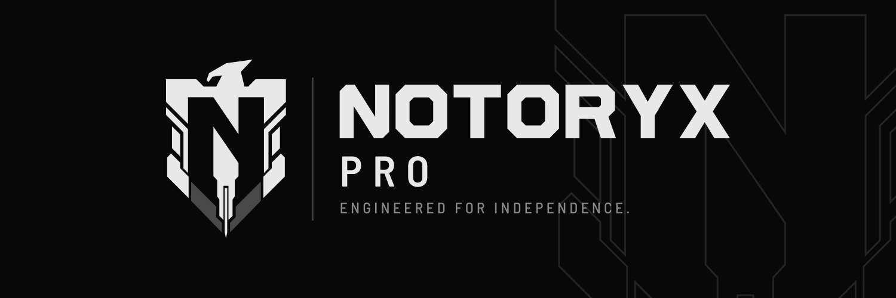</p>

# NOTORYX PRO

**One app for MeshCore and Meshtastic LoRa radios.** Part of the **NOTORYX** off-grid communications family. **No Towers. No Limits.**

NOTORYX PRO talks to both kinds of radio from the same app: connect a MeshCore companion and a Meshtastic node, and chat, map and manage both from one place.

Downloads are published in **[notoryx-PRO-releases](https://github.com/TheLogsAreScreaming/notoryx-PRO-releases/releases)**, not here.

<table>
  <tr>
    <td>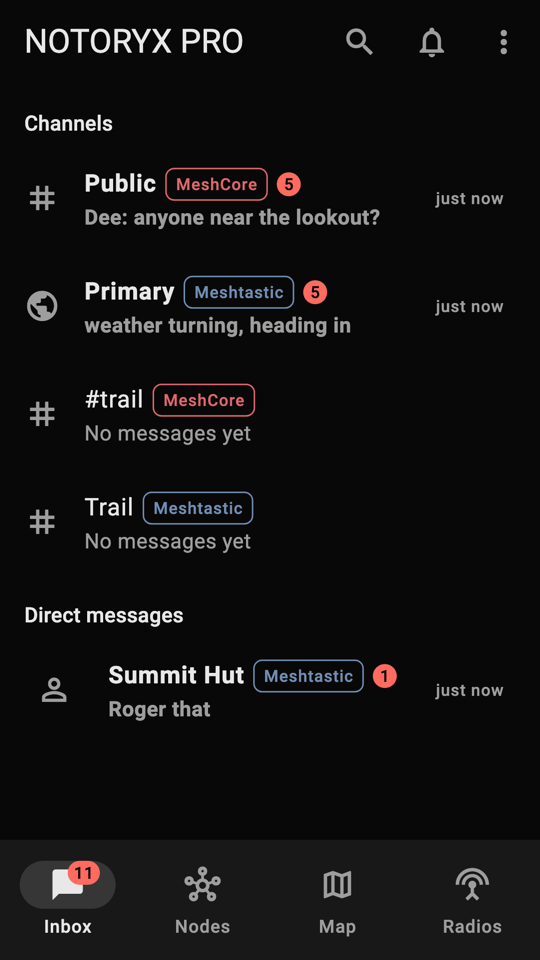</td>
    <td>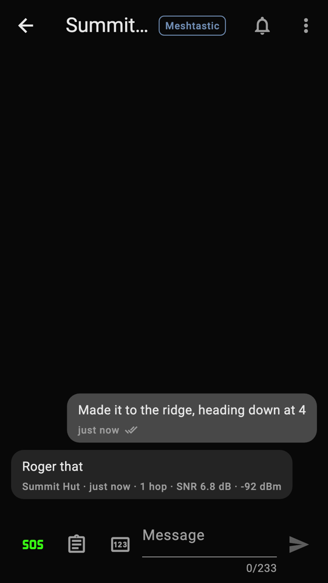</td>
    <td>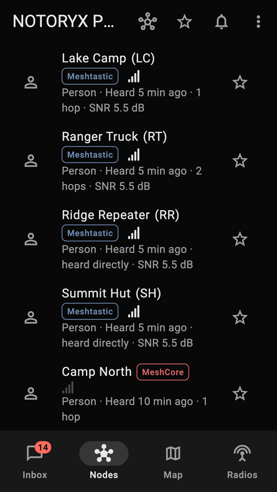</td>
    <td>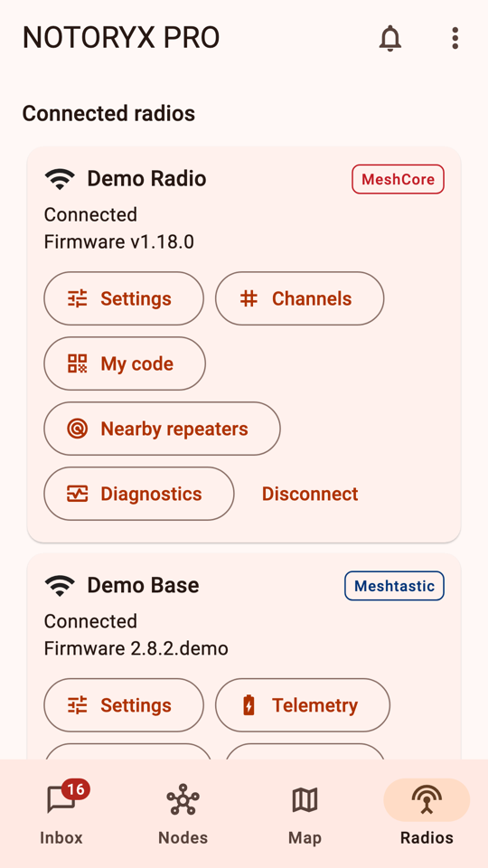</td>
  </tr>
  <tr>
    <td align="center">One inbox</td>
    <td align="center">Conversation</td>
    <td align="center">Nodes</td>
    <td align="center">Both radios at once</td>
  </tr>
  <tr>
    <td>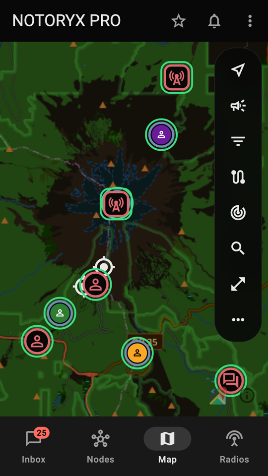</td>
    <td>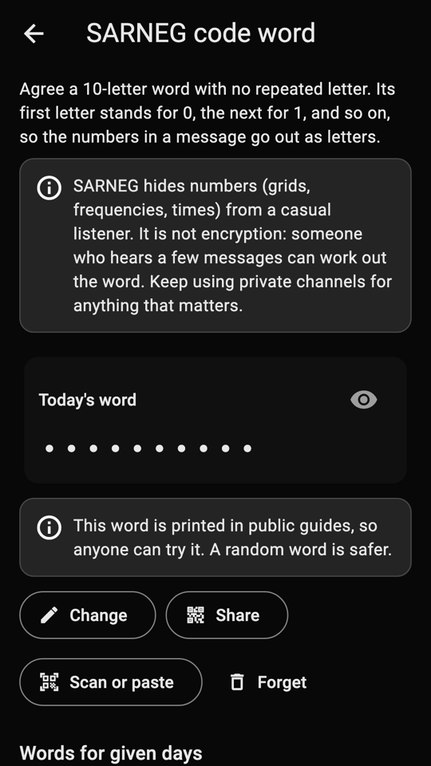</td>
    <td>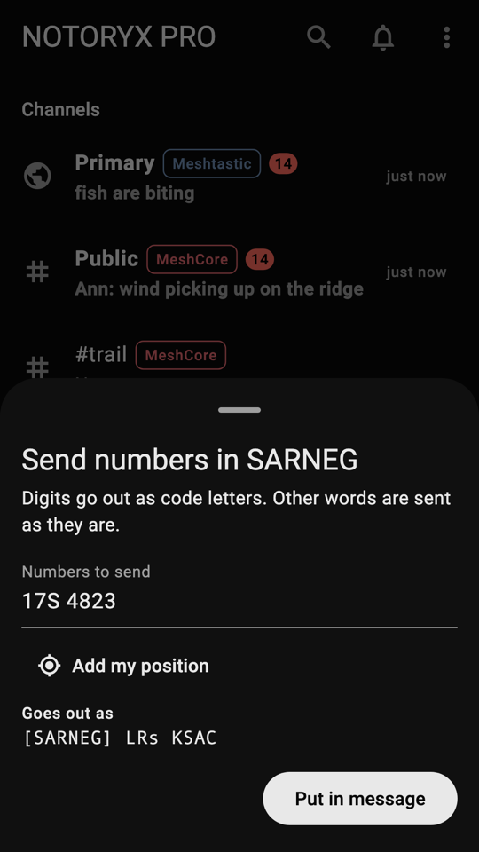</td>
    <td>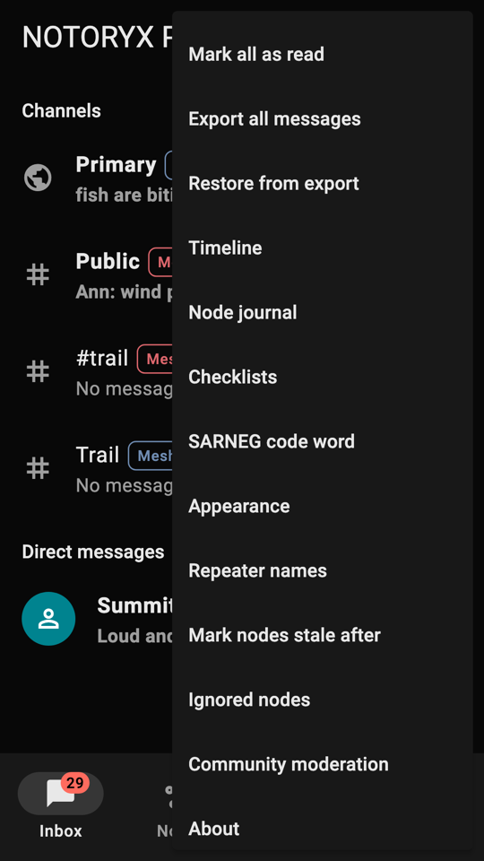</td>
  </tr>
  <tr>
    <td align="center">One map</td>
    <td align="center">SARNEG code word</td>
    <td align="center">Numbers as letters</td>
    <td align="center">Tools and settings</td>
  </tr>
  <tr>
    <td>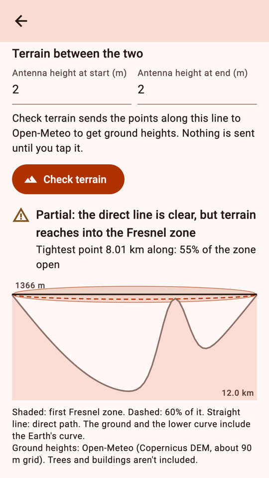</td>
    <td>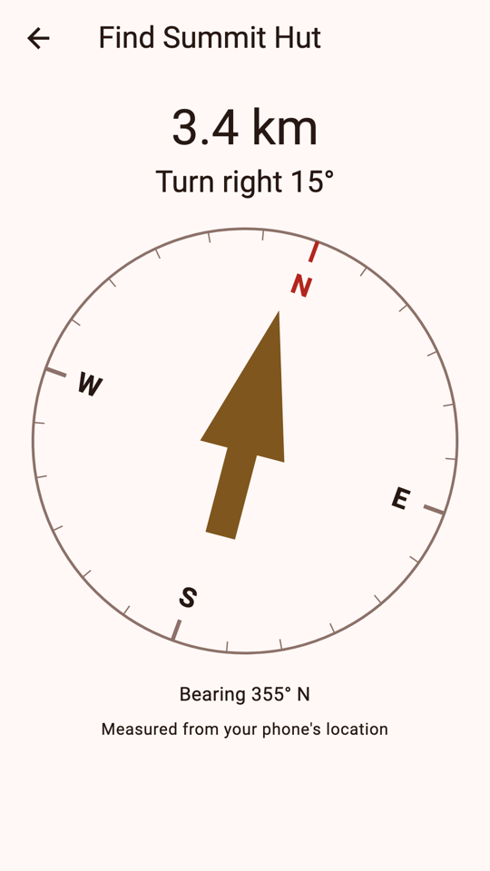</td>
    <td>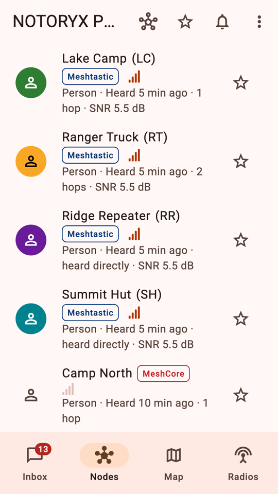</td>
    <td>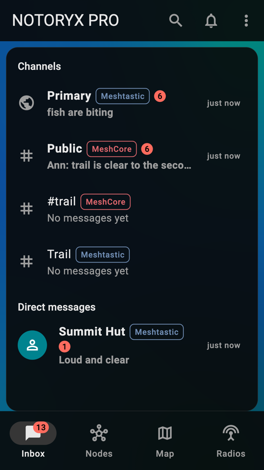</td>
  </tr>
  <tr>
    <td align="center">Line of sight with terrain</td>
    <td align="center">Compass to a node</td>
    <td align="center">Node colours</td>
    <td align="center">Glass backgrounds</td>
  </tr>
  <tr>
    <td>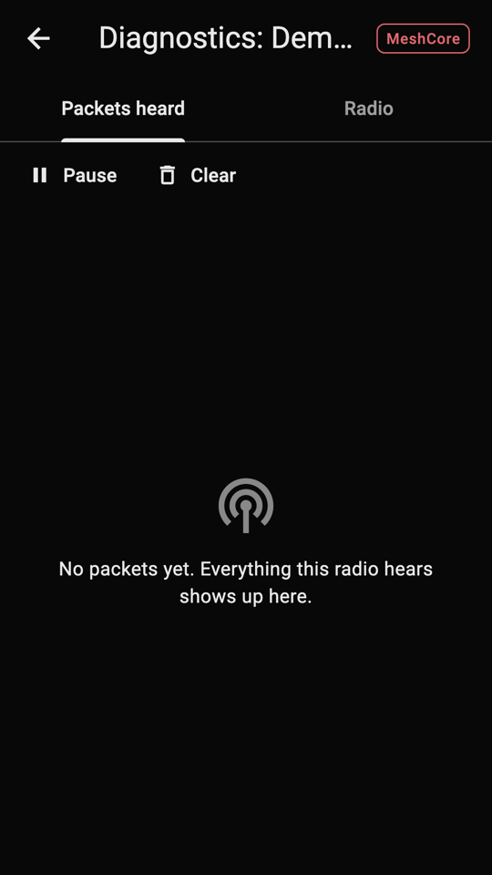</td>
    <td>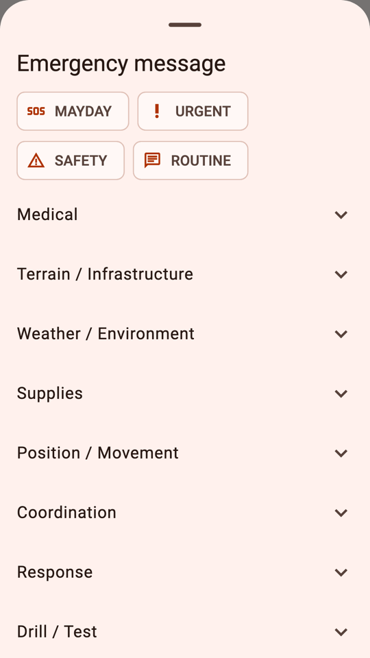</td>
    <td>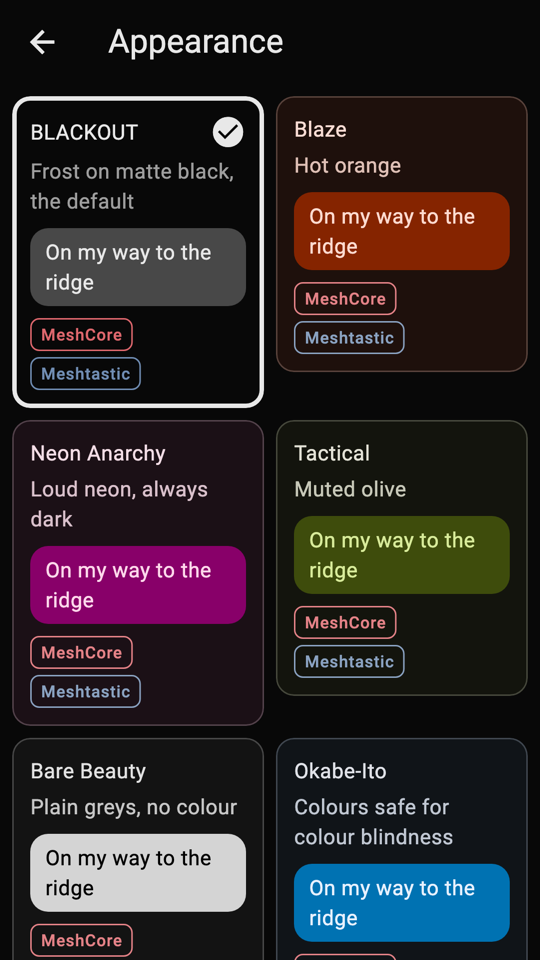</td>
    <td>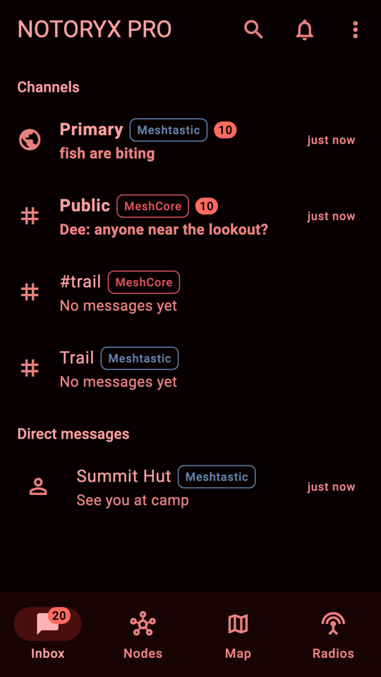</td>
  </tr>
  <tr>
    <td align="center">Diagnostics</td>
    <td align="center">Emergency messages</td>
    <td align="center">Seven themes</td>
    <td align="center">Night Ops</td>
  </tr>
</table>

Screenshots come from the app's demo mode (pretend radios, made-up names and places) in the default **BLACKOUT** look. They're rendered by `test/screenshots/`; see [Screenshots](#screenshots).

## Status: test 32 (0.32.0), 22 November 2026

The latest build is **[0.32.0 test 32](https://github.com/TheLogsAreScreaming/notoryx-PRO-releases/releases/tag/v0.32.0-test.32)** (build 37), a test build for Android, Mac and Windows. It brings the **BLACKOUT** look: BLACKOUT (frost on matte black) as the default theme and the new steel eagle-N app icon on every platform. Seasonal and Pink Overload were retired; anyone who had them picked gets BLACKOUT. Test 32 hasn't been tried on a phone or radio yet.

- **Checked on real hardware:** on a phone with a MeshCore and a Meshtastic radio: SARNEG (word rules, Show/Hide, share QR, coding and decoding on the demo radio, screenshots blocked on SARNEG screens; tests 29 to 31), old wrong MeshCore dates cleared (test 28), quiet ignored MeshCore channel posts and real MeshCore last-heard times (test 27), Back releasing the radio while Home keeps it connected (test 26), range rings and the stale-node badge (tests 24 to 27), and the live Traffic map and map toolbar (test 22). Earlier: connect and send on a test channel, node colours, compass and line of sight, and a moderation report reaching Sentinel.
- **Not tried on real radios yet:** SARNEG over the air, most features added in tests 14 and 15 (trusted nodes, network diagram, off-route alerts, route picker, nearby repeater test, automations, day replay, node journal, checklists, identity key backup), and ignoring a MeshCore direct message (needs a second sender). They pass the automated tests and CI only. Please report what works.
- **Not yet built:** iPhone (needs an Apple developer account), Google Play and the App Store. The Mac build isn't notarized and the Windows build isn't code-signed.

## Features

### Both meshes, one app
- MeshCore and Meshtastic radios side by side, each speaking its own protocol, with one inbox, one map and one node list.
- Up to four radios at once, from either mesh.
- Bluetooth, USB (Android and Windows) and Wi-Fi links, with automatic reconnect and a connection log.
- Keeps the connection in the background.
- **Demo mode** with a pretend MeshCore and Meshtastic radio, for trying the app without one.

### Messaging
- Unified inbox by person and channel, unread counts, mute and notifications.
- Delivery ticks and retries (MeshCore direct, reset path, then flood; Meshtastic resend), and a card showing how each message arrived.
- Channels: create, join, leave and share by QR code or link.
- Forwarding, scheduled messages, search, delete and export.
- Auto-replies with ready-made presets, and automations (webhooks off by default).
- **SARNEG code words** (Inbox menu → SARNEG code word): send grid references, frequencies and times as letters instead of digits. Your team agrees on a 10-letter word with no repeated letter, or taps **Random word** (with the textbook example BLACKHORSE, `[SARNEG] LRs KSAC` reads as 17S 4823; the app warns that well-known words like that one are easy to guess). A SARNEG button in the message box codes the numbers before you press Send, and a received `[SARNEG]` message gets a tap-to-decode line. Share the word by QR code or text, and set a different word for given days. The word hides itself again after 30 seconds, copied SARNEG text is cleared from the clipboard after a minute, and screenshots and screen recording are blocked on SARNEG screens (Android, Windows, and Mac where macOS allows it). Works on both meshes with the same format as every NOTORYX app. It keeps numbers away from a casual listener; it is **not encryption**.
- Contacts beyond the radio's own limit.

### Map and navigation
- One map for both meshes with signal bars, MeshCore routes and offline use of every tile you've viewed.
- Route view and picker for MeshCore direct paths.
- Places: GPX import and export, geofences, link planner and off-route alerts.
- Day replay of where nodes were.
- **Live Traffic map** that draws heard packets hop by hop, a map toolbar, **range rings** around your position and a **stale** badge for nodes that have gone quiet (you choose how long).
- **Compass** that points to a node, with distance and "turn left/right".
- **Line of sight** between any two points, with Fresnel zone and Earth's curve, and an optional terrain profile from Open-Meteo (nothing is sent until you tap **Check terrain**).

### Diagnostics
- Live packet log, noise floor and channel activity.
- Trace route with each hop's signal, saved traces and shareable trace cards.
- Nearby repeater test, network diagram and a timeline of what happened.
- Delivery hints that explain why a message may not have arrived.
- Telemetry history with charts for Meshtastic nodes.

### Trust and safety
- Verified senders: QR codes, fingerprints, badges and name-clash warnings.
- Trusted nodes, identity key backup and a node journal.
- Ignore a node: its channel posts and messages are saved without a notification.
- MECP emergency messages with labels in 20 languages, a MAYDAY that gets through mute, and a manually started distress beacon. Emergencies show in neon green.
- SALUTE and 9-Line reports, and offline checklists.
- Community moderation: report a message, a Flagged label and appeals.

### Radio admin
- MeshCore: radio settings with area presets, adverts, repeater and room server admin, repeater names, the radio's command line and path-hash setting.
- Meshtastic: radio settings, module settings, remote admin over the mesh, fixed position and standard region setup.
- Other-mesh traffic, MQTT feeds and opt-in channel bridging.
- Airtime savers: Plus Codes and paced remote settings.

### Your look, your data
- Seven looks: **BLACKOUT** (the default: frost on matte black, no accent colour), Blaze, Neon Anarchy, Tactical, Bare Beauty, Okabe-Ito (colour-blind safe) and Night Ops (red on black for night vision). MeshCore red, Meshtastic blue, emergency green and warning red stay readable in every look, and each node can have its own colour or photo.
- Backgrounds: solid colour, gradient, mesh gradient or your own photo, with frosted glass panels.
- App lock, optional encryption of saved messages, password-protected backups, restore and team setup sharing.
- English, Spanish, French, German, Portuguese and Italian. Everything except English is machine-written and needs a native speaker's review.

## Install

Get the files from the **[latest test build](https://github.com/TheLogsAreScreaming/notoryx-PRO-releases/releases/tag/v0.32.0-test.32)**. Each test updates the previous one in place and keeps your messages.

| File | For |
|---|---|
| `NOTORYX-PRO-0.32.0-android-arm64.apk` | Most Android phones (64-bit ARM) |
| `NOTORYX-PRO-0.32.0-android.apk` | Any Android device (larger) |
| `NOTORYX-PRO-0.32.0-macos.zip` | Mac (Intel and Apple silicon), macOS 12 or later |
| `NOTORYX-PRO-0.32.0-windows-x64.zip` | Windows 10 and 11, 64-bit (never run on a real PC yet) |

- **Android:** download the APK on the phone, open it and allow installs from your browser or file manager when asked. Builds are signed with the NOTORYX PRO key, certificate SHA-256 `7419F685D2FBFDF533C2EE32034477531E3A414D8574320B079FC913183AFA70`.
- **Mac:** unzip, then right-click **NOTORYX PRO** → **Open** the first time (the app isn't notarized).
- **Windows:** unzip and run `notoryx_pro.exe`. If SmartScreen warns, choose **More info** → **Run anyway**.
- **Check the download:** each release has `SHA256SUMS.txt`.

## App IDs

| Platform | ID |
|---|---|
| Android | `com.bastionmesh.notoryx_pro` |
| iPhone / Mac | `com.bastionmesh.notoryxPro` |

These differ from NOTORYX Core, NOTORYX Independent and NOTORYX Connect, so all of them can be installed together.

## What makes it different

- **Both meshes, one app.** No switching apps to talk to a MeshCore and a Meshtastic radio.
- **Free and open.** No paid timers, no feature paywalls, source in this repository.
- **Clean-room code.** Written from the published MeshCore companion protocol and the Meshtastic protobuf definitions. No code is copied from other client apps; CI checks for that on every pull request.
- **Pro tools on every platform.** Packet log, noise floor, signal bars, line of sight with terrain and telemetry history on Android, Mac and Windows.
- **Built for the backcountry.** Offline maps, compass, connection health you can see and automatic reconnect.

## Building

CI is the build loop (`.github/workflows/ci.yml`): format, analyze, tests, the independence check and debug Android, iPhone, Mac and Windows builds. Test builds come from `release-build.yml`. Locally:

```bash
flutter pub get
flutter gen-l10n
flutter test
```

## Screenshots

The images above and the store screenshots are rendered from demo mode with real fonts, headless:

```bash
SCREENSHOTS=1 flutter test test/screenshots
```

PNGs land in `build/screenshots/` (`readme/` for the extra README shots, `<size>/<language>/` for the store sets). You can also run the **Store screenshots** workflow from the Actions tab and download the `store-screenshots` artifact. The README copies in `docs/screenshots/` are the English phone shots, shrunk to 960 px tall. The map shot fetches its OpenStreetMap tiles live; nothing else in the screenshot tests goes online.

## Privacy

The app has no accounts and no advertising, analytics or crash-reporting SDK. Its developer receives data only if you turn on Community moderation and send a report or appeal. See [docs/PRIVACY.md](docs/PRIVACY.md) and the [privacy policy](https://meshmayhem.org/privacy/notoryx-pro/).

## License

NOTORYX PRO is free software under the [GNU General Public License v3.0](LICENSE). The Meshtastic protocol definitions it uses are GPL-3.0 too, so the app as a whole is GPL-3.0: anyone can use, study, share and change it, and anyone who shares a changed version must share its source under the same license.

Emergency message labels come from the [MECP project](https://github.com/mecp-org/MECP)'s language files (CC BY 4.0); the MECP protocol itself is CC0. Encryption by [SQLite3MultipleCiphers](https://github.com/utelle/SQLite3MultipleCiphers) (MIT). Windows USB by [libserialport](https://sigrok.org/wiki/Libserialport) (LGPL-3.0). Map tiles © OpenStreetMap contributors. Elevation data from [Open-Meteo](https://open-meteo.com/) (Copernicus DEM).
